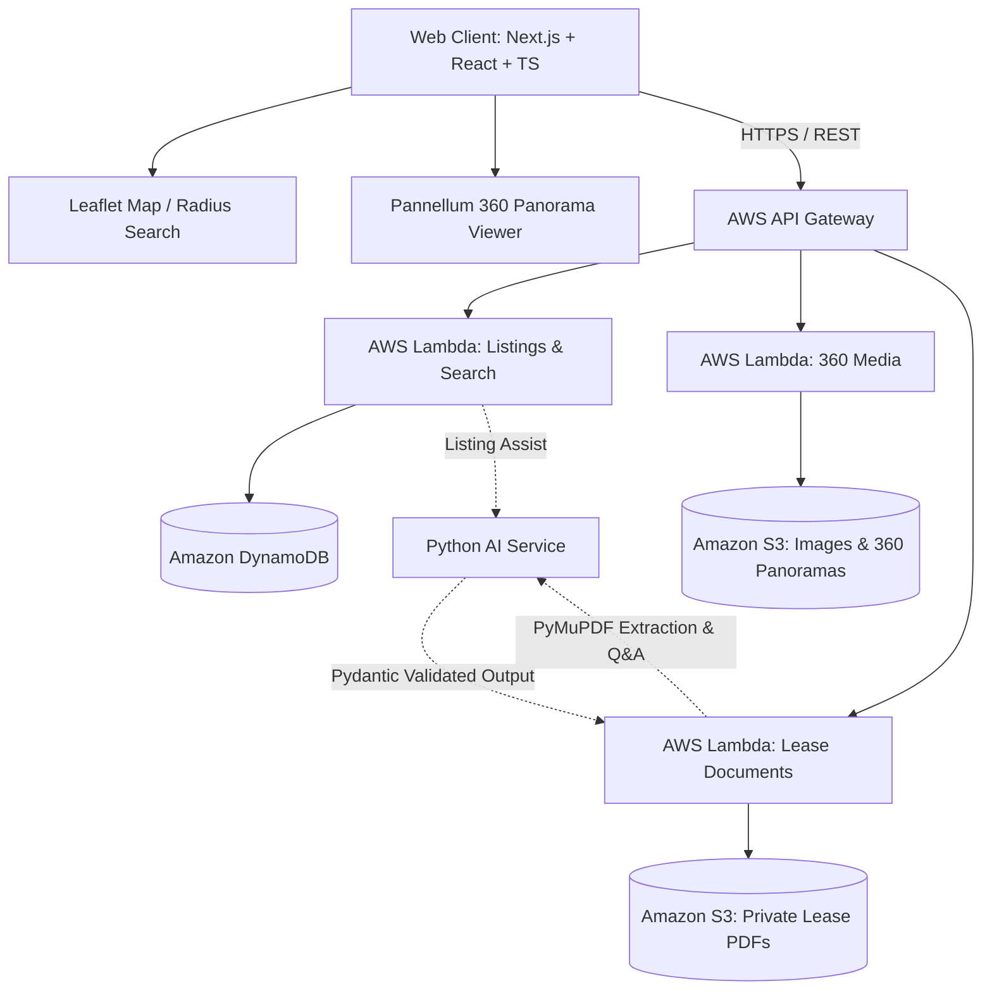

# RentVision System Architecture

RentVision is a modern web platform designed to streamline rental property discovery, virtual inspections, and lease comprehension in Ethiopia.

## Core Architectural Pillars

## System Components

### 1. Frontend Client (`apps/web`)
- **Next.js (React & TypeScript)**: App Router architecture providing server-side rendering, SEO performance, and responsive interfaces.
- **Leaflet**: Client-side mapping library for interactive boundary rendering and radius-based property filtering.
- **Pannellum**: WebGL-based equirectangular panorama viewer enabling immersive 360° virtual tours with room-to-room navigation hotspots.

### 2. Backend Compute & Ingress (`services/api`)
- **AWS API Gateway**: Manages API traffic, rate limiting, and CORS headers.
- **AWS Lambda**: Stateless execution environment scaling automatically with request demand, minimizing idle hosting costs.

### 3. Data & Storage Layer
- **Amazon DynamoDB**: Fast NoSQL database managing property metadata, geospatial coordinates, landlord accounts, and user profiles.
- **Amazon S3**: Segregated object storage buckets for public media (photos, equirectangular panoramas) and private encrypted documents (lease agreements).

### 4. AI & Document Processing (`services/ai`)
- **Pydantic**: Robust runtime validation and schema enforcement for listing metadata and extraction outputs.
- **PyMuPDF (fitz)**: High-performance PDF parser extracting structural text, terms, and clauses from lease agreements.
- **Assistance Pipelines**: Document question answering and listing optimization.

### 5. Infrastructure as Code (`infra`)
- **AWS CDK (TypeScript)**: Programmatic definition of AWS infrastructure ensuring reproducible, version-controlled cloud environments.
